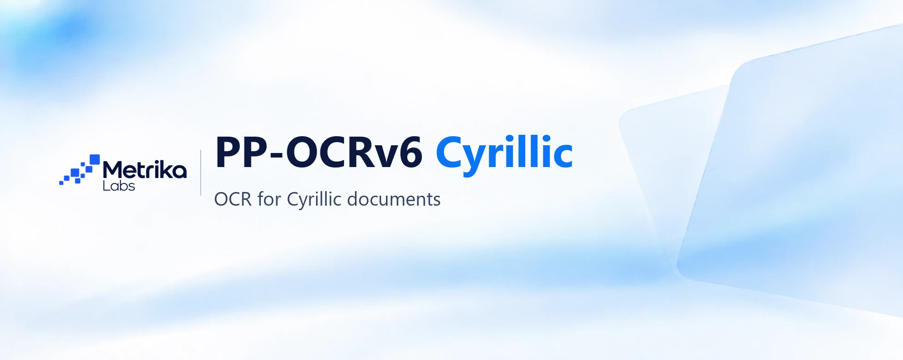
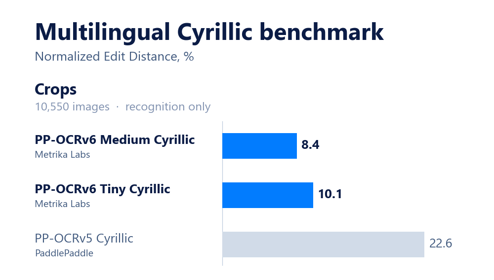
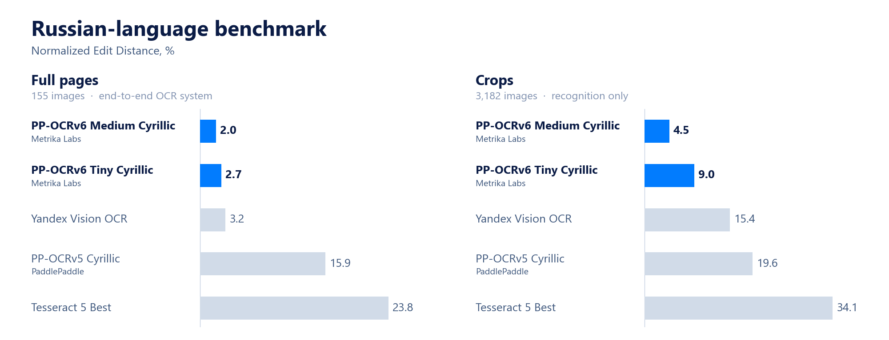

  
   
  
  

## Fast OCR models for printed and handwritten Cyrillic text, based on PP-OCRv6

Results on challenging OCR benchmarks featuring distortions, printing defects, and low-quality images.

Russian-language OCR benchmark: [ru-ocr-benchmark-hard](https://huggingface.co/datasets/metrika-labs/ru-ocr-benchmark-hard)

## Usage

### 🚀 Recommended for CPU (RapidOCR / ONNX)
* [**PP-OCRv6 Medium Cyrillic (RapidOCR)**](https://huggingface.co/metrika-labs/PP-OCRv6_medium_rec_cyrillic_onnx)
* [**PP-OCRv6 Tiny Cyrillic (RapidOCR)**](https://huggingface.co/metrika-labs/PP-OCRv6_tiny_rec_cyrillic_onnx)

### 🚀 Recommended for GPU (PaddlePaddle)
* [**PP-OCRv6 Medium Cyrillic**](https://huggingface.co/metrika-labs/PP-OCRv6_medium_rec_cyrillic)
* [**PP-OCRv6 Tiny Cyrillic**](https://huggingface.co/metrika-labs/PP-OCRv6_tiny_rec_cyrillic)

## Details
PP-OCRv6 is a family of fast, lightweight text recognition models from PaddlePaddle. The models were trained by Metrika Labs on 7.5 million varied examples of printed and handwritten text from real document scans and synthetic images.

80% of the examples are in Russian. The other 20% are in Kazakh, Belarusian, Uzbek, Tajik, Ukrainian, Bulgarian, Serbian, Macedonian, Tatar, Kyrgyz, Mongolian, Bashkir, Ossetian, Chuvash, Chechen, Yakut, Avar, and other languages that use Cyrillic.

The models work with PaddleOCR and are also available in ONNX format for fast CPU inference with RapidOCR.

The current version supports handwritten text only in Russian. It reads clear handwriting well, but may make mistakes with cursive or less legible handwriting.

 
PP-OCRv6 Medium: Мир меняется быстро (score: 0.9882) 
PP-OCRv6 Tiny: Пир меняется быстро (score: 0.8412) 

## Links

Benchmark for evaluating OCR model quality on Russian text: [metrika-labs/ru-ocr-benchmark-hard](https://huggingface.co/datasets/metrika-labs/ru-ocr-benchmark-hard)

Some handwriting examples come from [AntiplagiatCompany/HWR200](https://huggingface.co/datasets/AntiplagiatCompany/HWR200)

Original PaddleOCR repository: [PaddlePaddle/PaddleOCR](https://github.com/PaddlePaddle/PaddleOCR) 
RapidOCR repository: [RapidAI/RapidOCR](https://github.com/RapidAI/RapidOCR)
